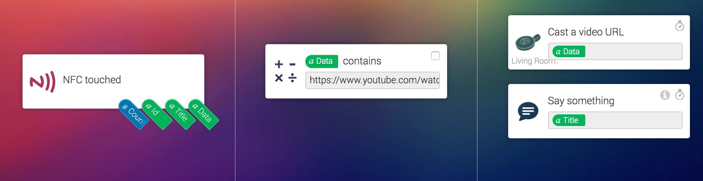
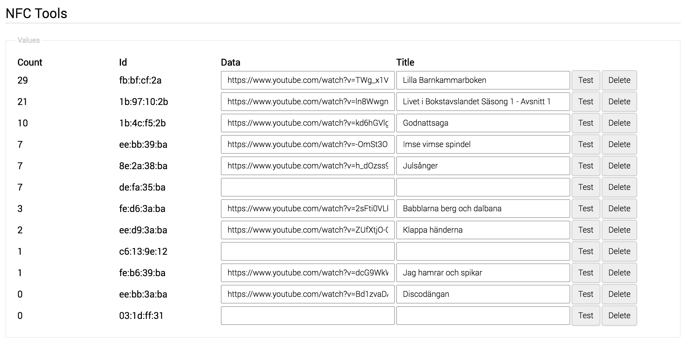

# NFC Tools

With this app you can register NFC cards in settings and add additional values to each card that can be used in flows as tags. It also have a counter so that you know how many times a card has been used.

## Changelog:

V2.0.0
* Updated to Homey Apps SDK v3, the new runtime required by Homey Pro (Early 2023). NFC tag scanning continues to work on Homey hardware that has an NFC antenna (e.g. Homey Pro 2019). Phone-based scanning support is planned for a future release.

V1.0.2
* Bundle Vue 3.2.31

V1.0.0
* Initial Release
